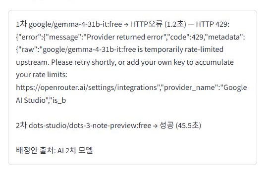

# 팀 프로젝트 팀 편성 웹 앱

중간 과제 제출물. 학생이 스스로 팀을 편성하고, 남은 학생은 AI가 배정하되 앱이
규칙으로 검사하는 Streamlit 웹 앱이다.

> 5~7항의 사례는 모두 실제로 앱을 돌려 보며 겪은 일이고, 화면과 커밋이 근거로
> 붙어 있습니다 (공고 6.3절 20번).

---

## 1. 배포 주소

<https://team-former-r4u2recj9fl5bept8qmuqp.streamlit.app/>

## 2. PRD와 구현 계획의 위치

| 문서 | 위치 |
| --- | --- |
| PRD | [`docs/PRD.md`](docs/PRD.md) |
| 구현 계획 | [`docs/구현 계획.md`](docs/구현%20계획.md) |

## 3. 고른 해결 방법

공고 3장 표의 7개 기능을 **모두 어려운 해결**로 만들었다.

| 기능 | 고른 것 | 어떻게 |
| --- | --- | --- |
| 다른 사람의 변경 보기 | 어려운 해결 | `st.fragment(run_every=5)` 로 바뀐 부분만 5초마다 다시 그림 ([`app/ui/student.py`](app/ui/student.py), [`app/ui/admin.py`](app/ui/admin.py)). 보험으로 `refresh` 단추도 함께 둠 |
| 필수 포함 역할을 지킬 수 없는 팀 | 어려운 해결 | 지원 단계에서 `남는자리 < 미충족` 이면 막음 ([`app/rules.py`](app/rules.py) `_structural_block`) |
| 같은 팀에 대기 중인 지원이 여럿 | 어려운 해결 | 승인 직전에 규칙을 다시 검사함. 처리 순서는 투표가 끝난 순서 ([`app/rules.py`](app/rules.py) `check_before_approval`, [`app/flow.py`](app/flow.py) `_try_approve`) |
| 마지막 자리에 두 명이 동시에 들어감 | 어려운 해결 | `tf_members` 의 `(team_id, slot_no)` 기본 키와 `student_id` 유일 제약으로 먼저 도착한 학생만 기록 ([`schema.sql`](schema.sql)) |
| AI 응답이 늦을 때 | 어려운 해결 | 모델마다 **전체** 120초를 재서 끊고 다음 모델로 넘어감 ([`app/ai.py`](app/ai.py) `_read_within_deadline`) |
| 3차 모델까지 실패 | 어려운 해결 | 2.5절 4항의 검사 다섯 가지를 모두 통과하는 배정을 완전탐색으로 끝까지 찾음 ([`app/flow.py`](app/flow.py) `solve_assignment`) |
| DB가 일시정지되지 않게 | 어려운 해결 | GitHub Actions 가 매일 DB 에 질의를 보냄 ([`.github/workflows/keepalive.yml`](.github/workflows/keepalive.yml)) |

### 필수 포함 역할 자리 계산

공고 3장의 설명을 다음 부등식으로 구현했다.

```
예상팀원 = 현재 팀원 ∪ {지원자}
남는자리 = 4 - |예상팀원|
충족수  = 예상팀원과 {기획자, 웹 프로그래머} 의 최대 매칭 크기
미충족  = 2 - 충족수

남는자리 < 미충족  →  막힘
```

부등식이어야 한다. 부록 2(중간) 8단계는 팀4가 학생11(RW) 혼자여서 충족수가 0인데
학생12가 지원하면 남는자리 2·미충족 2 이므로 막히지 **않아야** 하고(기대 결과:
대기), 부록 3(어려움) 11단계는 남는자리 1·미충족 2 이므로 막혀야 한다(기대 결과:
막힘). 두 단계가 서로를 검증하는 쌍이라, "필수 역할이 없으면 막는다" 로는 둘을
동시에 통과할 수 없다.

## 4. 쓴 모델 3개

| 차수 | 모델 | 고른 이유 |
| --- | --- | --- |
| 1차 | `google/gemma-4-31b-it:free` | 지시형(instruct) 모델이라 JSON 형식을 잘 지킴 |
| 2차 | `dots-studio/dots-3-note-preview:free` | 1차와 제공자가 다름. 실제 배정에서 두 번 다 성공함 (45.5초, 87.9초) |
| 3차 | `nvidia/nemotron-3-ultra-550b-a55b:free` | 또 다른 제공자. 셋이 함께 막히지 않게 함 |

제공자를 셋 다 다르게 골랐다. 무료 모델은 한 제공자가 혼잡하면 그 곳 모델이
동시에 429 를 내므로, 같은 곳의 모델로 체인을 채우면 넘어가는 의미가 줄어든다.

고르기 전에 쓸 수 있는 무료 모델을 모두 호출해 보고 정했다. 그 과정에서 확인한 것:

- `thinkingmachines/inkling*:free` 는 HTTP 403 `only available on agentic
  harnesses` 를 돌려주어 일반 API 로는 쓸 수 없다
- 추론형 모델은 생각하는 데 토큰을 다 써서 빈 응답을 내는 일이 잦다.
  `max_tokens` 를 4096 에서 16384 로 올리자 빈 응답이 사라졌다
- 무료 모델 목록은 수시로 바뀐다. `scripts/check_setup.py` 가 고른 세 모델이
  지금 살아 있는지 확인해 준다

기본값은 [`app/ai.py`](app/ai.py) 의 `DEFAULT_MODELS` 이고, `.env` 의
`AI_MODEL_1/2/3` 으로 바꿀 수 있다. 무료 모델로 자동 연결하는 라우터
(`openrouter/free`)는 쓰지 않는다.

> **제출 전에 확인하세요.** 오픈라우터의 무료 모델 목록은 수시로 바뀝니다.
> <https://openrouter.ai/models?max_price=0> 에서 위 세 모델이 살아 있는지 보고,
> 없어졌으면 `.env` 와 이 표를 함께 고치세요.

## 5. 오픈라우터 AI 모델 호출 실패 사례

### 사례 — 1차 모델이 HTTP 429 로 거절되어 2차 모델로 넘어감

배포한 앱에 관리자로 로그인해 쉬움 명단(학생 8명, 팀 3개)을 올리고 모집을 마감한
뒤 **AI 배정**을 눌렀다. 1차 `google/gemma-4-31b-it:free` 가 1.2초 만에 HTTP 429
(`temporarily rate-limited upstream`, 제공자 Google AI Studio)를 돌려주었다. 앱이
이를 실패로 보고 2차 `dots-studio/dots-3-note-preview:free` 로 넘어갔고, 2차가
45.5초에 배정안을 냈다. 그 배정안은 2.5절 4항의 검사 다섯 가지를 모두 통과해
확정되었다.

화면: 

DB 기록(`tf_ai_logs`)에도 같은 내용이 남아 있다. 같은 실패는 한 번으로
그치지 않았다. 부록 2(중간) 시나리오를 배포한 앱에서 다시 밟았을 때도 1차가
0.3초 만에 같은 429 를 냈고 2차가 87.9초에 성공했다.

| 차수 | 모델 | 상태 | 걸린 시간 |
| --- | --- | --- | --- |
| 1차 | `google/gemma-4-31b-it:free` | HTTP오류 (429) | 1,186ms |
| 2차 | `dots-studio/dots-3-note-preview:free` | 성공 | 45,493ms |

### 사례 — 120초를 넘겨 앱이 끊고 다음 모델로 넘어감

모델을 고르는 동안 `nvidia/nemotron-3-ultra-550b-a55b:free` 를 1차로 두고 같은
배정을 요청했을 때, 응답이 오지 않아 앱이 **121.3초에 연결을 끊고** 2차 모델로
넘어갔다. 모델마다 전체 대기 시간을 재는 어려운 해결이 동작한 것이다. 이때
1차는 `시간초과`, 2차는 HTTP 429, 3차는 빈 응답이어서 결국 앱이 스스로 배정했고,
그 배정도 검사를 통과했다.

## 6. 클로드가 잘못된 추론이나 답변을 한 사례

### 사례 — 보조 역할을 통째로 망가뜨리는 SQL 을 만들었음

클로드가 쓴 조회 SQL 이 이랬다.

```sql
coalesce(array_agg(r.role ...), '{}')
```

PostgreSQL 에서 `'{}'` 는 타입이 정해지지 않은 문자열이라, 이 식 전체가 배열이
아니라 **text 로 풀린다.** 그래서 보조 역할이 `'{보고서 작성자,발표자}'` 라는
문자열로 돌아왔고, 파이썬의 `tuple()` 이 이를 글자 단위로 쪼개어
`('{', '보', '고', …)` 로 만들었다. 모든 학생의 보조 역할이 깨지므로, 보조
역할로 기획자나 웹 프로그래머를 맡는 판정(2.3절)이 전부 틀어질 상황이었다.

**알아챈 방법**: 실제 Supabase 에 붙여 `tests/test_postgres.py` 를 돌렸더니
`test_sub_roles_keep_their_csv_order` 와 `test_student_with_no_sub_role` 이
`assert ('{', '}') == ()` 로 실패했다. 인메모리 저장소로 돌릴 때는 통과하던
검사였다. **커밋 `6d59374`** 에서 양쪽을 `text[]` 로 못박아 고쳤다.

### 사례 — 진행 안내에서 모델 이름이 깨짐

클로드가 진행 안내를 `"{모델이름}: {상태}"` 꼴로 적었는데, 무료 모델 이름이
`:free` 로 끝나므로 뒤의 콜론과 합쳐져 `:free:` 가 되었다. Streamlit 이 이를
이모지 단축표기로 보고 🆓 로 바꾸어 모델 이름이 `…0324🆓 HTTP오류` 처럼 보였다.

**알아챈 방법**: 브라우저로 앱을 띄워 AI 배정을 눌러 보다 화면에서 발견했다.
**커밋 `b45ee92`** 에서 구분자를 화살표로 바꾸고 안내를 `st.text` 로 그려
마크다운 해석을 막았다.

## 7. 본인이 제출한 앱에서 발견한 문제점이나 개선 필요 사항

### 문제 — AI 배정 중에 관리자 화면이 멈춘 것처럼 보임

부록 1(쉬움) 6단계 "관리자가 마감하고 배정, 확정" 에서, **AI 배정** 을 누른 뒤
배정안이 나올 때까지 **46초 동안** 관리자 화면 전체가 입력을 받지 않았다.
`AI 배정 진행`(`assign_status`)에 "2차 모델의 응답을 기다리는 중 (16초 경과)"
처럼 진행 상황은 보이지만, 그 사이 다른 단추는 누를 수 없다. 1차·2차·3차가
모두 늦으면 최대 6분까지 이 상태가 이어진다.

화면:  (이 화면이 나오기까지 46초가 걸렸음)

원인은 모델 호출을 화면을 그리는 흐름 안에서 그대로 기다리기 때문이다. 고치려면
배정을 백그라운드 작업으로 돌리고 화면은 상태만 주기적으로 읽어 가게 해야 한다.
이번 제출에서는 공고가 요구하는 진행 안내(몇 차 모델을 기다리는지)를 보여 주는
선에서 멈췄다.

### 문제 — 창을 여러 개 열면 단추 반응이 7초를 넘김

부록 2(중간) 시나리오를 배포한 앱에서 학생마다 창을 따로 열어 밟다가 찾았다.
창이 늘수록 단추를 누르고 `result` 가 바뀌기까지가 길어졌다.

| 연 창 | 눌렀을 때 result 가 바뀌기까지 |
| --- | --- |
| 3개 (3단계) | 4.9초 |
| 6개 (4단계) | 6.8초 |
| 9개 (7단계) | **10.5초** |

공고 2.7절은 채점 프로그램이 단추가 나타나기를 7초까지 기다린다고 적고 있다.
어려움 시나리오는 학생이 16명이므로 그대로 두면 더 나빠질 상황이었다.

**원인을 좁힌 방법**: 브라우저에서 클릭부터 재어 보니 서버가 처리를 *시작*하기까지는
58ms 였고 *끝내기*까지가 6,296ms 였다. 쓰기가 전혀 없는 `새로 고침` 도 같았다.
느린 것은 화면 한 번을 그리는 일 자체였다. 학생 화면은 `team_of`, `is_closed`,
`pending_application_of`, `all_team_members`, `incoming_applications` 를 따로 물어
왕복이 다섯 번이었고(질의 하나가 284ms), `st.fragment` 는 5초마다 다시 그리므로
모든 세션이 쉬지 않고 화면만 그리는 상태였다. 그래서 누른 단추가 뒤로 밀렸다.

**커밋 `98a7456`** 에서 다섯 번을 SQL 한 문장으로 합쳐 1,764ms → 590ms 가 되었다
(3배). `tests/test_postgres.py` 가 커서의 `execute` 를 세어 왕복이 한 번인지 확인하고,
한 번에 가져온 값이 따로 물은 값과 같은지 대조한다.

함께 고친 것: `새로 고침` 이 `st.rerun` 을 다시 불러 같은 읽기를 두 번 하고 있었다.
단추를 누르는 것만으로 fragment 가 처음부터 다시 돌고 그 처음에서 이미 DB 를 다시
읽으므로 필요 없는 호출이었다.

**남은 것**: 배정 확정은 아직 느리다. 중간 시나리오 11단계에서 학생 8명을 한 번에
넣는 데 17.5초가 걸렸다. 학생마다 자리를 잡고 넣는 질의가 따로 나가기 때문이고,
한 번에 넣도록 합칠 여지가 있다. 관리자가 한 번 누르는 동작이라 이번 제출에서는
그대로 두었다.

---

## 사례를 채우는 방법

5~7항은 사례만 적으면 부분 점수를 받고, 근거(화면, 커밋, 시나리오 단계)까지
적으면 점수를 다 받는다(공고 7.1절 8항). 아래 순서로 하면 근거가 저절로 모인다.

### 5항 — AI 호출 실패

이 앱은 오픈라우터 호출을 모두 `tf_ai_logs` 테이블에 남긴다. 관리자 화면의
「AI 배정 진행」(`assign_status`)에도 차수·모델·상태·소요 시간이 그대로 보인다.

1. 연습용 시나리오를 마감까지 진행하고 **AI 배정**을 누른다.
2. 무료 모델은 일곱 번 가운데 세 번쯤 실패하므로, 몇 번 돌리면 `시간초과`,
   `HTTP오류`(429), `빈응답`, `검사실패` 가운데 하나가 반드시 나온다.
3. 그 화면을 캡처해 `img/` 에 저장하고 5항에 파일 이름을 적는다.
4. 더 자세한 기록이 필요하면 Supabase SQL Editor 에서:
   ```sql
   select created_at, attempt_no, model, status, elapsed_ms, detail
   from tf_ai_logs order by created_at desc limit 20;
   ```

밤에 돌리면 무료 모델이 더 자주 실패한다(공고 4.3절).

### 6항 — 클로드의 잘못된 추론

앞으로 이 앱을 고치면서 클로드가 틀리는 일이 생기면 그때 적는 것이 가장 정확하다.
알아챈 근거로 쓸 수 있는 것은 두 가지다.

- **테스트**: `pytest` 가 잡아낸 실패. 어느 시나리오 몇 단계가 틀렸는지 테스트
  이름에 적혀 있다.
- **커밋**: `git log --oneline` 으로 고친 커밋의 해시를 찾아 적는다.

### 7항 — 발견한 문제점

아래 「연습용 시나리오 직접 해 보기」를 따라 세 시나리오를 손으로 돌려 보고,
기대 결과와 다른 단계나 불편한 점을 적는다. 화면이 몇 초 멈춘 것처럼 보이는 것도
개선 필요 사항이다.

---

## 처음 설정하기

### 1) 파이썬 환경

```bash
python -m venv .venv
```

```bash
.venv/Scripts/python.exe -m pip install -r requirements-dev.txt
```

### 2) Supabase

6장 실습에서 만든 프로젝트를 다시 쓴다. 새 프로젝트를 만들지 않는다(무료
프로젝트는 2개까지만 만들 수 있다).

DB 주소는 반드시 **풀러(Supavisor) 주소**를 쓴다. Streamlit Community Cloud 는
IPv4 로만 접속하는데, Supabase 무료 프로젝트의 직결 주소
(`db.xxx.supabase.co:5432`)는 IPv6 전용이어서 배포한 앱에서 연결이 안 된다.
Supabase 대시보드 > **Connect** > **Session pooler** 의 주소를 복사한다.

### 3) `.env`

[`.env.example`](.env.example) 을 복사해 `.env` 로 저장하고 값을 채운다.

```bash
cp .env.example .env
```

파일 이름은 정확히 `.env` 여야 한다. 편집기가 `.env.txt` 로 저장하면
`.gitignore` 가 걸러 내지 못해 키가 깃허브에 올라간다(공고 6.3절 7번, -3점).

### 4) 테이블 만들기

```bash
.venv/Scripts/python.exe scripts/apply_schema.py
```

Supabase 대시보드의 SQL Editor 에 [`schema.sql`](schema.sql) 을 붙여 넣어도 된다.
여러 번 실행해도 안전하다.

설정이 제대로 되었는지 한 번에 점검한다.

```bash
.venv/Scripts/python.exe scripts/check_setup.py
```

비밀 값이 있는지, DB 주소가 풀러 주소인지(직결 주소면 경고한다), `tf_` 테이블이
다 있는지, 고른 모델 3개를 지금 쓸 수 있는지 알려 준다. 값 자체는 출력하지 않는다.

### 5) 로컬에서 돌려 보기

```bash
.venv/Scripts/python.exe -m streamlit run streamlit_app.py
```

### 6) 배포

1. 깃허브에 **비공개** 저장소로 올린다.
2. Streamlit 의 Workspace settings > Linked accounts 에서 Private access 옆
   **Connect here** 를 누른다.
3. 앱을 만들 때 Branch 는 `main`, Main file path 는 `streamlit_app.py` 로 한다.
4. Secrets 칸에 `.env` 와 같은 이름으로 넣는다.
   ```toml
   OPENROUTER_API_KEY = "sk-or-v1-..."
   DATABASE_URL = "postgresql://..."
   ADMIN_PASSWORD = "..."
   ```
5. 배포 뒤 앱의 Settings > Sharing 에서 "Who can view this app" 을
   **This app is public and searchable** 로 바꾸고 Save changes 를 누른다.
6. 로그인하지 않은 브라우저(시크릿 창)로 배포 주소를 열어 로그인 화면이 보이는지
   확인한다. 채점 프로그램은 로그인하지 않은 브라우저로 앱을 연다.

### 7) DB 일시정지 막기

깃허브 저장소 > Settings > Secrets and variables > Actions 에서 `DATABASE_URL`
이라는 이름으로 풀러 주소를 넣는다. 그러면
[`.github/workflows/keepalive.yml`](.github/workflows/keepalive.yml) 이 매일 DB 에
질의를 보낸다. Actions 탭에서 **Run workflow** 로 한 번 손수 돌려 성공하는지
확인한다.

---

## 테스트

```bash
.venv/Scripts/python.exe -m pytest -q
```

부록 연습용 시나리오 3개(쉬움 6단계, 중간 11단계, 어려움 15단계)의 **모든 단계**를
단계별로 재현해, 결과 안내의 첫 단어가 기대 결과와 같은지 확인한다. DB와 키가
없어도 돌아간다.

| 테스트 | 확인하는 것 |
| --- | --- |
| `test_rules.py` | 팀 규칙, 막힘 사유, 승인 직전 재검사, 확정 검사 |
| `test_scenarios.py` | 부록 시나리오 3개의 전 단계와 기대 결과 |
| `test_roster.py` | CSV 파싱. 나눠 준 세 파일과 손으로 적은 명단이 같은지 |
| `test_ai.py` | 모델 전환, 전체 120초 끊기, 응답 해석 |
| `test_assign.py` | AI 성공·실패와 자율 배정, 배정 불가 판정 |
| `test_auth.py` | 비밀번호 해시, 틀린 비밀번호 거부, 관리자 분리 |
| `test_keys.py` | 공고 2.7절 표의 key 와 글자까지 같은지 |
| `test_ui_wiring.py` | 화면이 그 key 들을 실제로 쓰는지, 겹치지 않는지 |
| `test_store_contract.py` | `PgStore` 와 인메모리 저장소가 같은 계약을 지키는지 |
| `test_postgres.py` | 실제 DB. 아래 환경 변수가 있을 때만 돈다 |

실제 Supabase 에 대고 확인하려면(tf_ 테이블 내용이 지워진다):

```bash
TEAM_FORMER_TEST_DB=1 .venv/Scripts/python.exe -m pytest tests/test_postgres.py -v
```

---

## 연습용 시나리오 직접 해 보기

명단은 [`fixtures/`](fixtures) 에 있다. 단계와 기대 결과는 공고 부록에 있다.

1. 브라우저를 열고 학번 `admin` 과 관리자 비밀번호로 로그인한다.
2. 「명단 올리기」에 `fixtures/쉬움.csv` 를 넣고 팀 수를 **3** 으로 하여
   **명단으로 처음 상태 만들기** 를 누른다.
3. 학생마다 **다른 브라우저 창**(또는 시크릿 창)으로 로그인한다. 같은 창에서
   로그아웃하며 번갈아 해도 되지만, 투표를 주고받을 때는 창을 따로 두는 쪽이 편하다.
   학생 비밀번호는 모두 `1234` 이다.
4. 부록의 단계를 위에서부터 그대로 하고, 「결과 안내」의 첫 단어가 기대 결과와
   같은지 본다.
5. 중간 시나리오는 팀 수 **4**, 어려움 시나리오도 팀 수 **4** 다.

---

## 구조

```
streamlit_app.py            진입점
app/
  rules.py                  팀 구성 규칙 (DB·화면 의존 없는 순수 함수)
  flow.py                   지원·투표·마감·배정 흐름
  assign.py                 AI 배정과 자율 배정의 조합
  ai.py                     오픈라우터 모델 체인
  auth.py                   로그인과 bcrypt 해시
  roster.py                 명단 CSV 파싱
  store.py                  저장소 계약
  repo.py                   Supabase 구현 (SQL 은 여기에만)
  db.py                     커넥션 풀
  config.py                 .env / Streamlit Secrets
  roles.py                  6개 역할
  ui/                       화면 (keys.py 에 공고 2.7절의 key)
schema.sql                  DDL
scripts/apply_schema.py     스키마 적용
scripts/check_setup.py      설정 점검 (비밀 값, DB, 모델)
scripts/keepalive.py        DB 깨우기
fixtures/                   연습용 명단 CSV 3개
tests/                      테스트
docs/                       PRD, 구현 계획
```

규칙이 DB와 화면을 모르는 순수 함수라서, Supabase와 오픈라우터 키 없이도 부록
시나리오 전 단계를 테스트로 확인할 수 있다. 자세한 설계 근거는
[`docs/구현 계획.md`](docs/구현%20계획.md) 에 있다.

## 비밀 값

오픈라우터 키, DB 주소, 관리자 비밀번호는 `.env`(로컬)와 Streamlit
Secrets(배포)에만 둔다. 코드에 적지 않고 화면과 로그에 출력하지 않는다. 있는지
확인할 때는 `config.secret_status()` 가 "있음/없음" 만 돌려준다.
